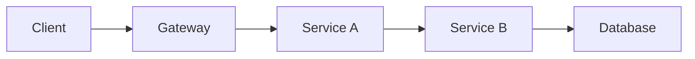
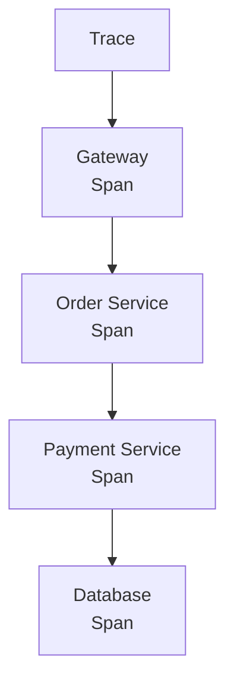
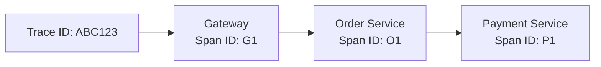
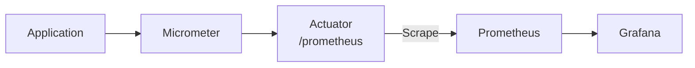
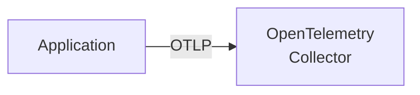
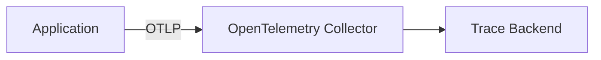
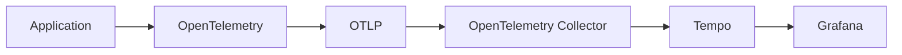
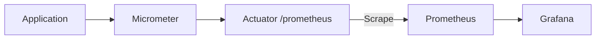
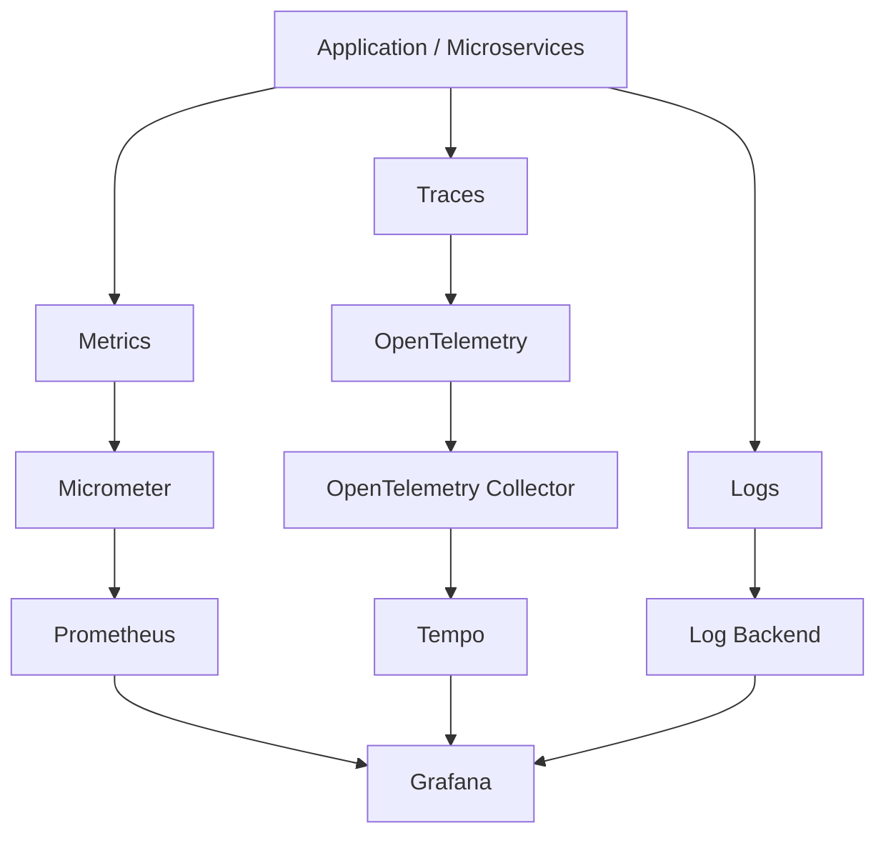
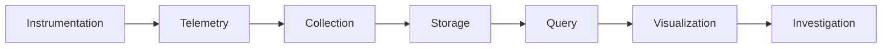

import Quote from '../../components/Quote.astro';

Let's Understand Observability

There is a point in every developer's life where `System.out.println()` stops being a debugging strategy. Mine came the day I deployed something, watched it work, and then got a message that just said:

`The application is slow.`

Cool. Great. Thanks. Which service? Is the database slow? Are requests failing somewhere? Is the app quietly eating memory in a corner? Did one endpoint decide today was the day it would take four seconds?

And underneath all of that, the real question: how do you know what's happening inside a system you can't actually see?

That's what observability is supposed to answer.

---

## So, what exactly is observability?

The word sounds fancier than it is.

At its core, observability just means you can understand what's happening inside a system by looking at the data it produces, instead of guessing based on vibes. Instead of asking "what do I think is happening," you get to ask "what does the data say is happening."

This starts to matter a lot once your app stops being one tidy process and becomes five services having a conversation you're not part of:



Now something takes three seconds. Without observability, you open five different log files and start guessing which one is lying to you. With observability, you can just ask the system directly. That's the whole pitch.

---

## The three things people won't stop talking about

Every observability conversation eventually circles back to the same three words: metrics, logs, traces. They get lumped together so often it's easy to assume they do the same job. They don't.

| Signal | Question it helps answer |
| :---    | :--- |
| Metrics | **What is happening?** |
| Logs | **What happened?** |
| Traces | **Where did this request go?** |

Let's take them one at a time.

---

## 1. Metrics

Metrics are just numbers, collected over time. Boring in the best way.

```text
Requests per second: 250
Error rate: 1.2%
CPU usage: 67%
Memory usage: 72%
P95 latency: 420ms
```

They're useful precisely because they're boring and consistent. If your app usually handles 100 requests a second and suddenly it's handling 800, you don't need a philosophy degree to know something changed. Same with latency going from 200ms to 1800ms overnight. Metrics are good at showing trends, and trends are usually the first hint that something's wrong before anyone even complains.

### Counters

A counter is something that basically only goes up, like `http_requests_total`. Every request bumps it. From there you can work out requests per second, and other things nobody wants to calculate by hand.

### Gauges

A gauge is something that moves both directions. JVM memory, CPU usage, active threads, queue size. If memory goes from 2GB to 3GB and back down to 2.5GB, that's a gauge behaving completely normally, not a memory leak sending you a warning.

### Histograms

Histograms are where latency measurement actually gets interesting. Say a thousand requests come in. They don't all take the same time; most bunch up somewhere reasonable and a few decide to take a leisurely stroll. A histogram captures that whole distribution, which is how you get numbers like P50, P95, and P99.

---

## What is P95, actually?

Say you want to know how fast your API is. The obvious move is to average all the response times. Add them up, divide by count, done.

Except an average lies. If 999 requests take 50ms and one takes 10 seconds, your average looks fine, maybe 60ms, while that one poor user is sitting there watching a spinner. Averages smooth out exactly the slow requests people actually notice and complain about. You need a way to measure the slow end specifically, not blend it into the crowd. That's what percentiles are for.

A percentile just answers: if I sort every response time from fastest to slowest, where does a given cutoff land?

```text
P50 (median)   → 50% of requests were this fast or faster
P90            → 90% of requests were this fast or faster
P95            → 95% of requests were this fast or faster
P99            → 99% of requests were this fast or faster
```

So if your numbers look like this:

```text
P50: 120ms
P90: 300ms
P95: 500ms
P99: 1800ms
```

P50 tells you what a typical request feels like. P95 and P99 tell you what your worst-off users are dealing with. That gap between P95 (500ms) and P99 (1800ms) is the part an average would've hidden completely, and it's often where the real complaints come from.

---

## 2. Logs

Logs are the detailed, specific record of what happened.

```text
2026-09-20 18:42:11
Payment request received
account=1234
amount=5000
```

or, less pleasantly:

```text
ERROR
Failed to connect to database
connection timeout
```

If metrics tell you "error rate is 4%," logs are what tell you it's because the database connection timed out. Metrics flag that something's wrong. Logs are usually where you find out what, specifically, went wrong.

---

## 3. Traces

This is the part that actually made things click for me.

Picture a request moving through a distributed system:

```text
Client
  ↓
Gateway
  ↓
Order Service
  ↓
Payment Service
  ↓
Database
```

That single request produces one trace, and inside that trace are multiple spans, one per step of the journey:



Each span is one operation. Put together, they show you exactly where the request went and how long it spent at each stop.

### Trace ID vs Span ID

A trace gets a Trace ID, something like `4bf92f3577b34da6a3ce929d0e0e4736`. Every span belonging to that request shares that Trace ID, but each span also has its own Span ID:



Same trace, different spans. That's what lets the tracing system stitch the whole journey back together afterward.

### Why this actually matters

Say a request takes 2.4 seconds. Metrics can tell you P95 latency jumped to 2.4 seconds. Useful, but it doesn't tell you where those seconds went. A trace might show you this instead:

```text
Gateway              50ms
Order Service        100ms
Payment Service      2.1s
Database             150ms
```

Now you have an actual suspect. Without the trace you're just staring at five services wondering which one to interrogate first.

---

## But where does all this data actually go?

This is the part where observability starts sounding like alphabet soup. You'll run into Micrometer, Prometheus, Grafana, OpenTelemetry, OTLP, the OpenTelemetry Collector, Tempo, and it looks like seven tools all doing the same job. They're not. Each one has a distinct, fairly narrow role, and once that clicks, the whole ecosystem stops feeling like a conspiracy.

### Micrometer

Micrometer is an instrumentation facade for JVM apps. It gives your application a consistent way to record metrics: request counts, latency, JVM memory, CPU, thread pools. Think of it as the thing inside your app that actually measures stuff. It's not where the data lives, just how it gets recorded.

### Prometheus

Prometheus collects and stores metrics. The flow looks roughly like this:



Prometheus periodically scrapes your app's metrics endpoint and stores whatever it finds, so you can query it later with something like:

```promql
rate(http_server_requests_seconds_count[5m])
```

which gives you an approximate request rate.

### Grafana

Prometheus is great at storing and querying numbers. Staring at raw PromQL output all day is not, generally, a good time. Grafana is where you actually look at the data from Prometheus, Tempo, and friends:

```text
Prometheus → Metrics
Tempo      → Traces
Grafana    → Visualization
```

Grafana doesn't store anything itself. It's the window you look through, not the thing behind the glass.

### OpenTelemetry

OpenTelemetry provides the standards and instrumentation for collecting telemetry, usually traces, metrics, and logs. In a tracing setup, your app creates spans and hands them off to OpenTelemetry to send elsewhere.

### What is OTLP?

OTLP is the OpenTelemetry Protocol. That's genuinely it. It's a transport format, not a database, not Grafana, not Tempo. It's how telemetry travels from one place to another:



### The OpenTelemetry Collector

The Collector sits between your apps and wherever telemetry ends up:



Why add another moving part? Because the Collector can receive, process, batch, route, and export telemetry to different backends, which gives you a clean boundary between your application code and your observability infrastructure. Nobody wants their app directly coupled to Tempo's connection details.

### Tempo

Tempo is a trace backend. Its whole job is storing traces so they can be queried later. The tracing path ends up looking like this:



And the metrics path is its own separate thing:



Prometheus and Tempo aren't competing for the same job, they're just handling different signals entirely.

---

## Putting the whole picture together



The exact tools will vary depending on the stack, but the responsibilities stay the same. Learn the shape once and you can slot in whatever your company happens to already be paying for.

---

## Docker will ruin your afternoon if you forget one rule

Once all of this runs inside Docker Compose, there's a rule worth tattooing somewhere: `localhost` inside a container means that container, not your other containers, no matter how obvious that sounds after the fact.

So this:

```text
http://localhost:4318
```

points the app right back at itself, which is exactly as useless as it sounds. What you actually want is the Docker Compose service name:

```text
http://otel-collector:4318
```

Same idea applies elsewhere:

```text
Collector → tempo:4317
Grafana   → http://tempo:3200
Grafana   → http://prometheus:9090
```

These work because everything's sitting on the same Docker network, gossiping by service name.

### Do you need to expose every port?

No, and this trips people up too. There's a difference between a container port and a published host port. A service can happily listen inside Docker without that port ever touching your actual machine.

You'd expose things like:

```text
Grafana     → localhost:3000
Prometheus  → localhost:9090
```

because you're opening those in a browser. But the Collector and Tempo can talk to each other entirely inside the Docker network, with nothing published to the host:

```text
Application → otel-collector:4318
Collector   → tempo:4317
Grafana     → tempo:3200
```

If nothing outside Docker needs to reach it directly, don't publish the port. Less surface area, fewer things to explain to your future self at 2am.

---

## Provisioning beats clicking around

Here's a lesson that took embarrassingly long to sink in: observability configuration shouldn't live only inside someone's browser tab. Grafana can be configured entirely through source-controlled files, datasources and dashboards included.

That means when someone spins up the project fresh, Grafana already knows Prometheus exists, Tempo exists, and these specific dashboards should be there, without anyone manually recreating a dashboard they built six months ago and completely forgot how they did. Reproducibility matters more the more people touch the project.

---

## The cardinality problem, or how to accidentally set Prometheus on fire

Metrics have a concept called cardinality, and it's the kind of thing you only learn about after breaking something.

Take `http_requests_total` and add labels like `method="GET"` and `status="200"`. Fine. There's a small, fixed number of methods and status codes.

Now add `user_id="12345"` as a label. Suddenly every single user creates a brand new time series: `user_id="12345"`, `user_id="12346"`, `user_id="12347"`, forever. With enough users, congratulations, you've built a very expensive way to make Prometheus sad.

The same warning applies to trace IDs, correlation IDs, API keys, raw user IDs, and dynamic request paths. Those belong in logs or traces, not as metric labels. A decent rule of thumb:

> Metrics describe the system at an aggregate level. Traces and logs are for investigating individual events.

---

## A practical example, because theory only gets you so far

Someone reports "the application is slow." Here's how the three signals actually work together instead of just sitting in a diagram looking nice.

**Step 1, metrics.** Check request rate, error rate, P95 latency, CPU, memory, thread pools. Say P95 latency jumped from 300ms to 2s. Now you know there's a real problem, not just a bad feeling.

**Step 2, trace.** Find a slow request and look at where the time went:

```text
Gateway           30ms
Order Service     50ms
Payment Service   1.8s
Database          100ms
```

Payment Service is clearly where the trail leads.

**Step 3, logs.** Check the Payment Service logs around that time window and find:

```text
Database connection pool exhausted
```

Now you have a concrete, fixable problem instead of a vague complaint. That's the three signals actually earning their keep together, not three separate tools you happen to have open in different tabs.

---

## Observability is not just a dashboard

This was probably the biggest thing I had wrong going in. It's tempting to think observability equals a nice Grafana dashboard, but a dashboard is just one way of looking at the data, not the whole point.



Fifty beautiful dashboards nobody checks isn't the goal. Making the system understandable when something goes wrong is.

---

## What good observability should let you answer

For a production system, these are the questions I actually want answered without opening six tabs and praying:

- **Is the system healthy?** Metrics.
- **Are requests failing?** Metrics and logs.
- **Which endpoint is slow?** Metrics.
- **Where is this specific request spending its time?** Traces.
- **What exactly went wrong?** Logs and traces.
- **Is this isolated to one service?** Metrics and traces.
- **Did this start recently, or has it always been like this?** Metrics.
- **Can I reproduce the exact request journey?** Trace plus correlated logs.

---

## If you remember nothing else

```text
Metrics
"What is happening?"

Logs
"What happened?"

Traces
"Where did this request go?"
```

And the plumbing behind them:

```text
Micrometer   → instruments metrics
Prometheus   → stores metrics
OpenTelemetry → instruments/collects telemetry
OTLP         → transports telemetry
OTel Collector → receives/processes/routes telemetry
Tempo        → stores traces
Grafana      → visualizes and explores all of it
```

Once those jobs are clear in your head, the whole ecosystem stops feeling like a wall of acronyms someone invented to keep you out.

---

## Final thought

Observability isn't really about collecting more data or bolting on more tools. It's about cutting down how much guessing you have to do when something inevitably breaks at the worst possible time.

A metric tells you something changed. A trace shows you where. A log tells you why. Put together, debugging stops being "I think it might be this service" and starts being "here's exactly what the system is telling me."

That's a much better place to start from, and a much less stressful way to spend your evening.

*Still learning this stuff myself. The more distributed a system gets, the more it matters not just that you can build it, but that you can actually see what's going on inside it once it's out in the wild.*

---

If you want the raw notes I took while figuring all this out, they're here: [Observability notes on Notion](https://www.notion.so/Observability-3e28aa9670d280c781ddf3c9fa5afb86?source=copy_link).

I also wired this whole setup into [Kabootar](https://github.com/miswah/kabootar), if you want to see it actually running instead of just diagrammed. The specific commit where the observability stack went in is [here](https://github.com/miswah/kabootar/commit/7094930943accd16aebc63afe3a742511fcb80c4).