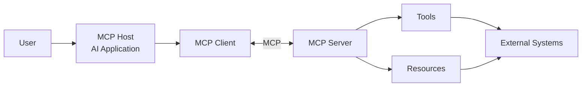

# I Built MCP From Scratch. Here's What I Learned.

I've been hearing a lot about **MCP — Model Context Protocol** lately. Like most developers, my first instinct was to see how easy it was to build one.

Install the SDK. Define a tool. Register it. Connect it to a client. Done.

And honestly, that's pretty cool. But then I had a slightly annoying question: **What is the SDK actually doing for me?**

Because "just use the SDK" is great when I want to ship something. It's not so great when I want to understand something. So I decided to do what is probably the less efficient thing to do.

**I built MCP from scratch.**

---

## Why?

I didn't want to build a production ready replacement for the MCP SDK. That would be a slightly ambitious weekend project.

The goal was much simpler:

**Understand how MCP actually works underneath the abstractions.**

I wanted to answer questions like:

- How does an MCP client discover tools?
- What does an MCP request actually look like?
- How does the server know which function to execute?
- How are parameters passed around?
- How does the server handle invalid requests?
- How does the client and server establish a session?
- What happens between sending a request and receiving a response?

The easiest way to answer those questions was to stop reading about them and build them.

---

## So What Exactly Is MCP?

At a high level, MCP is a standardized way for AI applications to communicate with external capabilities.

Think about an AI application that needs to:

- Search something
- Read a file
- Query a database
- Call an API
- Perform some calculation
- Access application-specific information

Without a common protocol, every AI application could end up implementing its own way of communicating with these external systems. MCP provides a standardized interface for this communication.

A simplified architecture looks something like this:



Underneath that, MCP splits into two layers. A **data layer**, built on JSON-RPC 2.0, that handles lifecycle management and the core primitives. And a **transport layer**, either STDIO for local processes or Streamable HTTP with SSE for remote ones.

MCP defines a handful of core primitives that servers can expose:

- **Tools** — executable functions the client can discover and invoke, the search/calculate/query kind of thing
- **Resources** — static or dynamic data the server can serve up, like files or database rows
- **Prompts** — predefined templates and workflows that guide how a model approaches a task, essentially reusable prompt structures the server hands to the client instead of every application having to write its own
- **Notifications** — one way messages that don't expect a response, useful for things like progress updates during a long running tool call

Most tutorials, mine included at first, focus almost entirely on Tools because they're the most immediately useful. But Prompts and Notifications are just as much a part of the spec, they just solve different problems, standardizing reusable prompt workflows and asynchronous updates instead of direct function calls.

---

## What I Actually Built

I kept the scope narrow on purpose. This isn't a full spec implementation, it's the core loop, built by hand.

The full code is on GitHub if you want to poke around: [sanket7474/mcp-from-scratch](https://github.com/sanket7474/mcp-from-scratch)

**Currently working:**

- **Tools** — functions the client can discover and invoke
- **Resources** — data the server can expose on request

I split the code into small, single-purpose files instead of one giant server:

```text
mcp-from-scratch/
│
├── src/
│   │
│   ├── core/
│   │   ├── dispatcher.js
│   │   ├── framing.js
│   │   └── jsonrpc.js
│   │
│   ├── util/
│   │   ├── registry.js
│   │   └── session.js
│   │
│   ├── client.js
│   └── server.js
│
├── package.json
├── README.md
└── .gitignore
```

- `framing.js` reads the raw stream off STDIO and figures out where one message ends and the next begins.
- `jsonrpc.js` implements the JSON-RPC 2.0 layer on top of that — requests, responses, notifications, errors.
- `dispatcher.js` is the part that made the protocol click for me. It takes an incoming method name, looks up the registered handler, and runs it. Once this existed, "how does the server know which tool to call" stopped being a mystery.
- `registry.js` tracks which tools and resources exist.
- `session.js` manages the connection lifecycle — initialization, capability negotiation, session state.
- `server.js` and `client.js` tie it together. A real server registering tools and resources over STDIO, and a minimal client I wrote just to poke at it and confirm things actually worked.

---

## What I Actually Learned

The honest takeaway: an MCP server is not "a list of tools with functions attached." That's the part every tutorial shows you, and it's also the smallest part of the actual work.

Underneath it there's a protocol handling:

- Communication
- Lifecycle
- Discovery
- Request routing
- Execution

None of that is optional. The SDK just does it quietly enough that you forget it's there.

Building it by hand didn't make me faster at shipping MCP servers. It made me stop treating the SDK as a black box, which was the entire point.

I didn't build this to have the most complete MCP implementation on GitHub. I built it because I wanted to actually understand the thing before I kept using it.